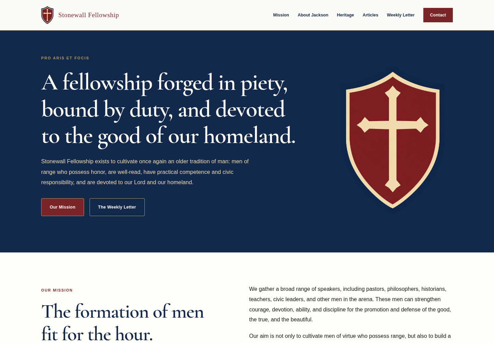
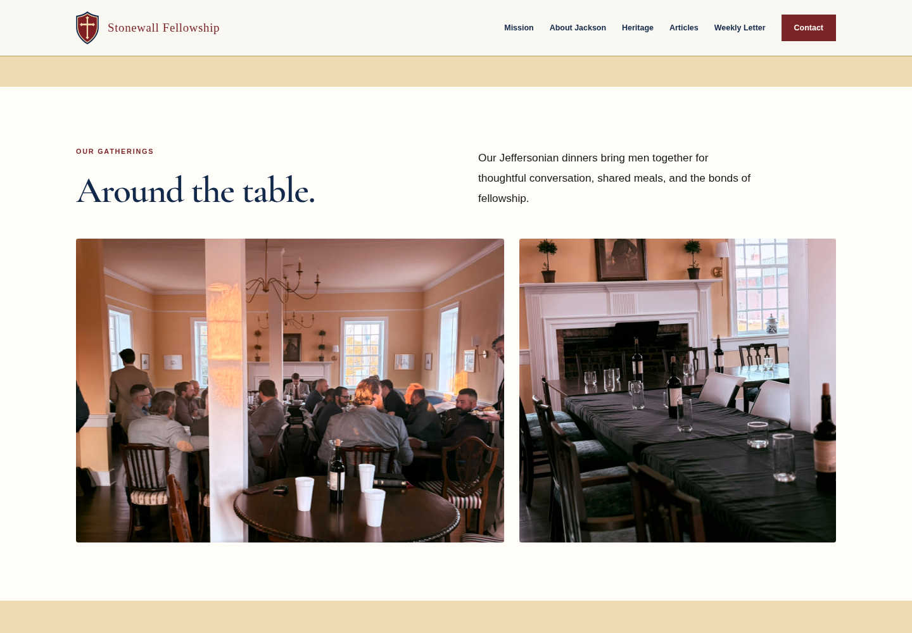
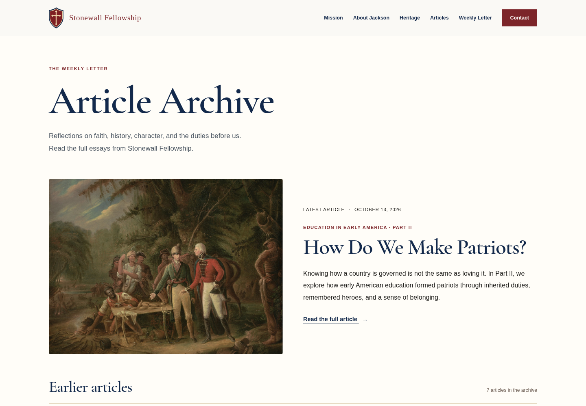
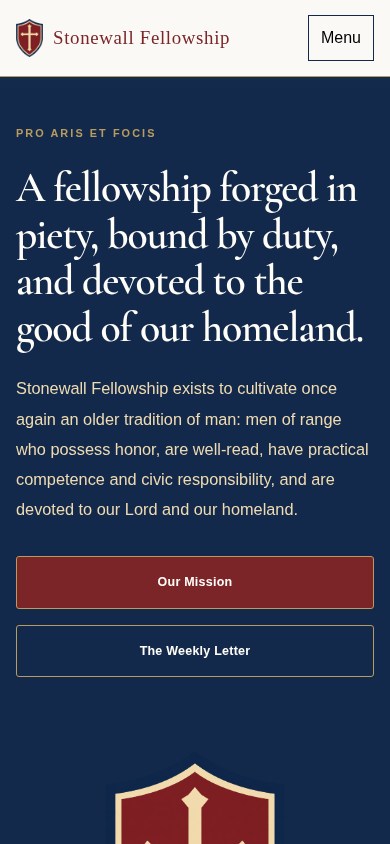

# Stonewall Fellowship

## View the redesign

These are actual Chromium browser screenshots of the implemented website, not generated mockups. Open an image to see it at full size. The live stonewallfellowship.com website has not been modified.

### Desktop homepage



### Gatherings



### Article archive



### Mobile homepage



[View the complete homepage screenshot](preview/full-homepage.png)

The exact approved font names were not supplied. Current fonts match the business-card style provisionally, and the shield is a derived preview cutout. Original master artwork and exact font identification are needed for final brand fidelity.

---

A responsive editorial redesign of stonewallfellowship.com. Preserves the public homepage content, all seven essays, original imagery, newsletter form destination, email address, and social links captured on October 12, 2026.

## Run locally

No dependency installation or build step is required. From this checkout:

```sh
python3 -m http.server 3000 --bind 0.0.0.0
```

Open the root page or `/articles/` using your development browser. The site is static HTML, CSS, and JavaScript. `refined.css` supplies the new design after the original stylesheets.

## Validation

Verified homepage rendering at desktop and mobile widths, image loading, mobile menu opening and closing, required newsletter fields, and all seven article pages. Newsletter delivery was not tested, as doing so would send a real signup. The original FormSubmit endpoint is retained.

## Deployment

Upload this directory to a static website host, preserving the article directory structure. This repository has not been connected to the live domain or deployed. The existing website remains unchanged. Existing canonical URLs are retained for the intended production domain.

## Brand reference update

The design now follows the supplied shield and business-card typography style. The website uses self-hosted UnifrakturMaguntia for the wordmark and Cormorant Garamond for headings as provisional style matches; the exact approved font names were not supplied. `assets/shield-cutout-preview.png` is a preview cutout derived from the supplied reference through image editing, not the original master artwork. Use the original master logo for final publication. The separately generated homepage image is a visual mockup, not a browser screenshot or a live website.
