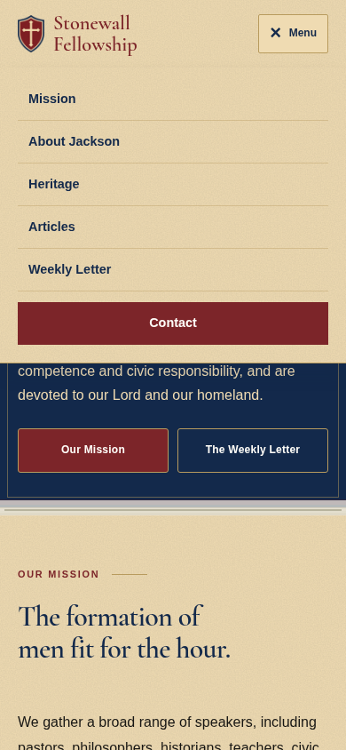
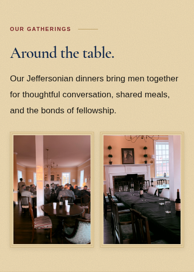
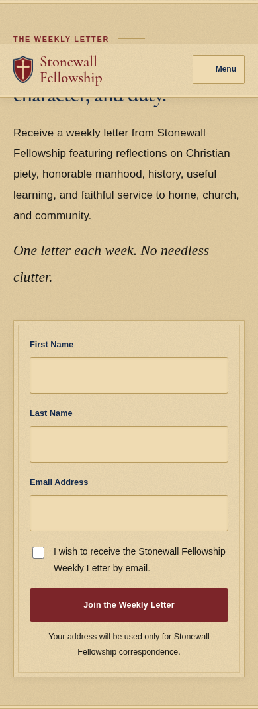
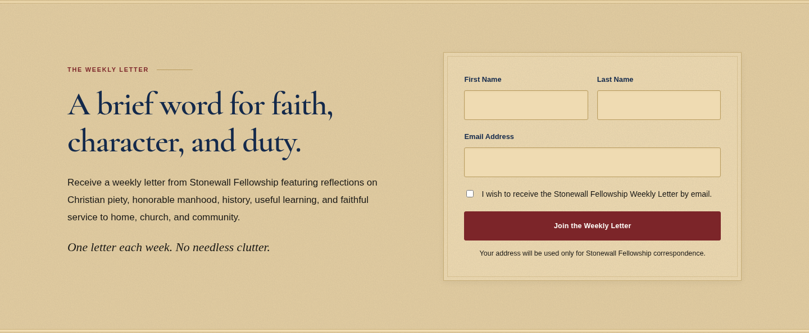

# Stonewall Fellowship

## View the redesign

The Home, Church, and Community decorative section has been removed as requested. The mobile layout now has a compact hero, paired action buttons, larger menu targets, balanced photo pairs, and comfortable newsletter fields. Below-the-fold images load lazily. The parchment palette and colonial trim remain.

These are actual Chromium browser screenshots of the implemented website. The live website has not been changed by this update.

### Mobile homepage


[View the complete mobile homepage](preview/mobile-full-homepage.png)

<details>
<summary>Mobile menu, gatherings, and newsletter</summary>







</details>

### Desktop homepage


<details>
<summary>Desktop gatherings, newsletter, and articles</summary>





</details>

[View the complete desktop homepage](preview/full-homepage.png)

The shield is the previously documented derived preview cutout; original master artwork is needed for exact logo fidelity.

---

A responsive editorial redesign of stonewallfellowship.com. Preserves all seven essays, newsletter form destination, email address, social links, and the remaining homepage content captured on October 12, 2026. The Home, Church, and Community section was deliberately removed at the user’s request; its original image files are retained in the repository.

## Netlify upload

[Download the prepared Netlify upload ZIP](https://github.com/codyblack845/yes-/raw/refs/heads/stonewall-preview/netlify-upload.zip). Extract it and upload the folder containing `index.html` to your existing Netlify project’s **Deploys** area when ready to publish. No build command or dependency installation is required.

[Read the upload instructions](NETLIFY.md). The clean package excludes screenshots, reports, Git metadata, setup tools, and test-submission data.

## Run locally

No dependency installation or build step is required. From this checkout:

```sh
python3 -m http.server 3000 --bind 0.0.0.0
```

Open the root page or `/articles/` using your development browser. The site is static HTML, CSS, and JavaScript. `refined.css` supplies the new design after the original stylesheets.

## Validation

[Read the complete content and functional audit](VALIDATION.md). All nine pages remain available. Apart from the requested Home, Church, and Community section removal, original text and links are retained. Browser checks cover desktop, tablet, mobile, and small mobile layouts. Real newsletter delivery remains unverified.

Verified homepage rendering at desktop and mobile widths, image loading, mobile menu opening and closing, required newsletter fields, and all seven article pages. Newsletter delivery was not tested, as doing so would send a real signup. The original FormSubmit endpoint is retained.

## Deployment

Upload this directory to a static website host, preserving the article directory structure. This repository has not been connected to the live domain or deployed. The existing website remains unchanged. Existing canonical URLs are retained for the intended production domain.

## Brand reference update

The design now follows the supplied shield and business-card typography style. The website uses self-hosted Cormorant Garamond for the nameplate and headings. The earlier blackletter nameplate was replaced with this clearer serif treatment at the user’s request. `assets/shield-cutout-preview.png` is a preview cutout derived from the supplied reference through image editing, not the original master artwork. Use the original master logo for final publication. The separately generated homepage image is a visual mockup, not a browser screenshot or a live website.
